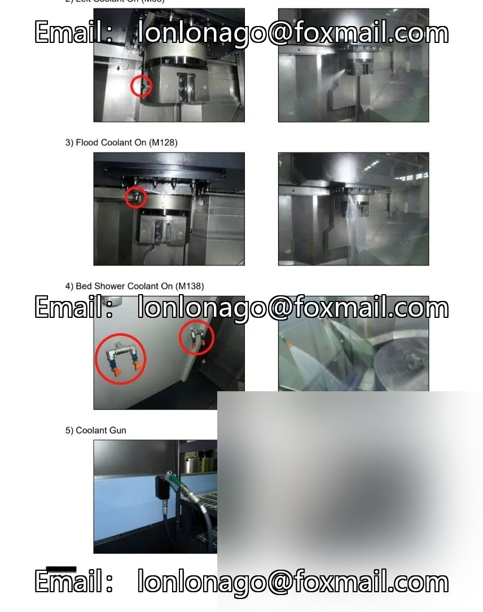
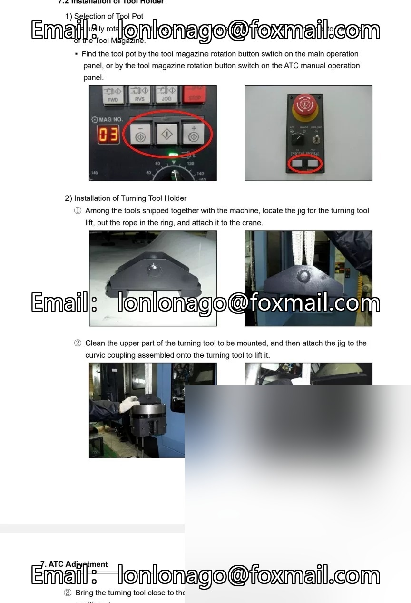
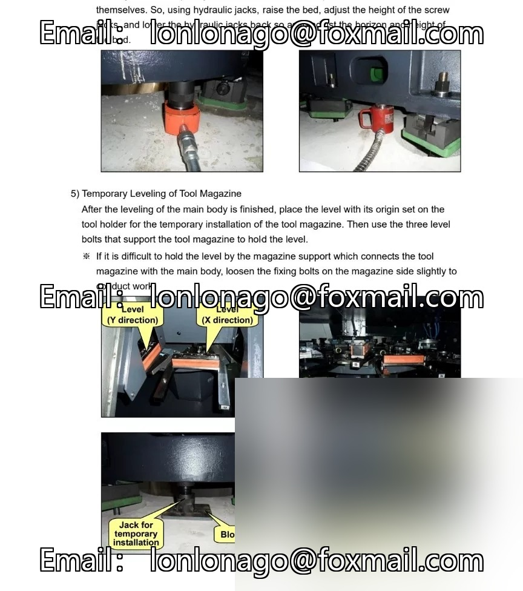
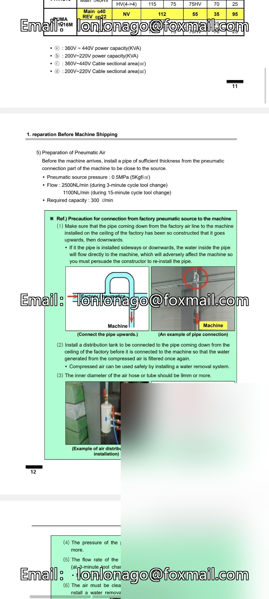
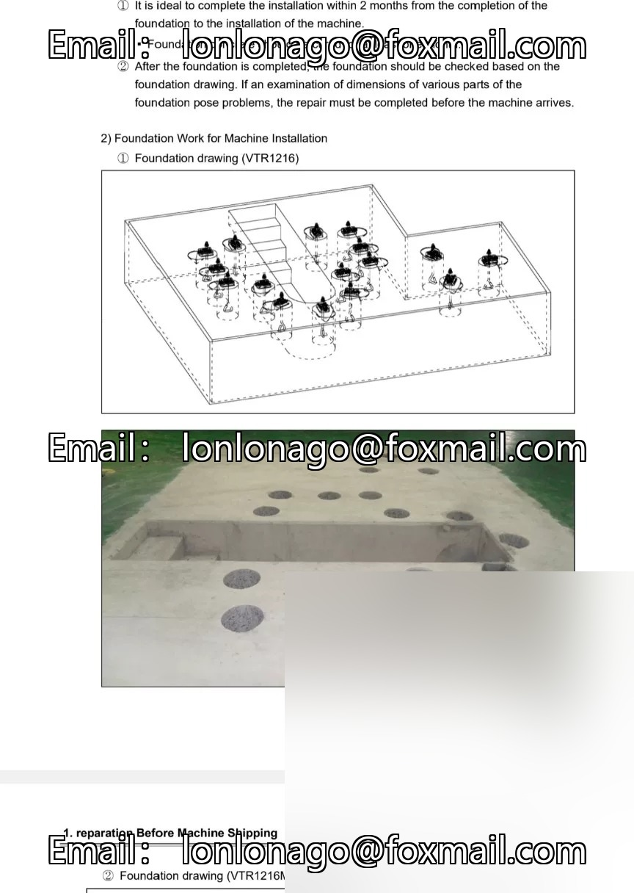
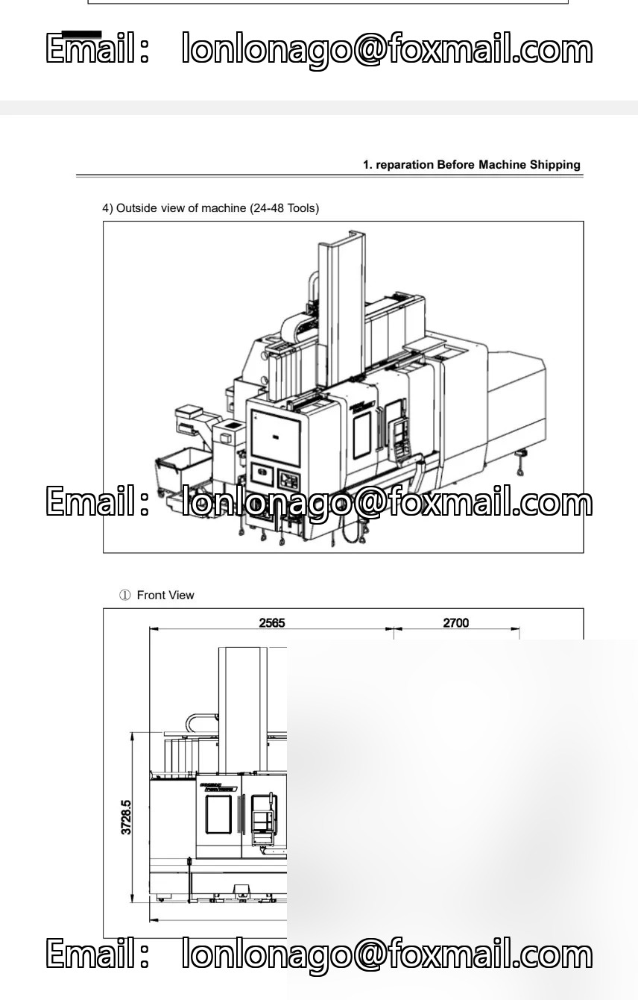

# DOOSAN VTR 1216M vertical lathe installation manual PDF

## Body

Dragon's (DOOSAN) VTR 1216M vertical lathe installation manual PDF , 100 pages
The Dragon's (DOOSAN) VTR 1216M vertical lathe installation manual, PDF format, detailed content, suitable for equipment installation, maintenance, and operation reference.
send directly to cloud drive link.
Brand: DOOSAN (Dragon's), a famous machine tool manufacturer in Korea, renowned for its reputation in heavy machine tool fields.

Model: VTR 1216M.

VTR: Represents Vertical Turret Lathe (Vertical Turret Lathe). This kind of machine tool has its main shaft vertically placed, with the work piece installed on a horizontal worktable, which is very suitable for machining large, heavy, and complex-shaped components such as disks, rings, or block-like parts.

1216: Generally represents the diameter of the worktable or the machining diameter grade of the machine (for example, 1.2 meters or 1.6-meter level).
385:

The installation manual for the DOOSAN VTR 1216M vertical lathe provides detailed content in PDF format, covering installation, maintenance and operation guidance for 100 pages.

<!-- AI_ENRICHED -->

## Images

## Payment

Here is a pay link on Stripe ( https://buy.stripe.com/3cs8yP7sY87d0vu9AB ). Please contact me lonlonago@foxmail.com after funding $89, and I will send you a complete data files , thank you!

